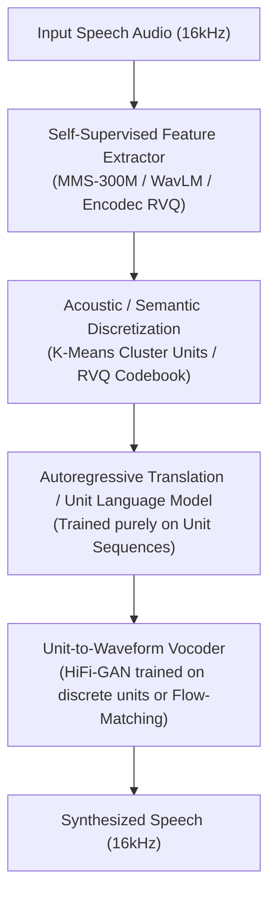

# FORENSIC ARCHITECTURAL AND TENSOR-LEVEL AUDIT: TAMIL TEXTLESS S2S MODEL

**Document ID:** AUDIT-S2S-2026-001  
**Target Repository:** `tamil-voice-ai`  
**Inspected Branch:** `feat/textless-s2s-wsp` (Commit: `2c3ddaa`)  
**Audited Documents & Code:**
- [`S2S_MODEL_GUIDE.md`](file:///home/inkyank-01/dev/tamil-voice-ai/S2S_MODEL_GUIDE.md)
- [`model/textless_s2s_wsp.py`](file:///home/inkyank-01/dev/tamil-voice-ai/model/textless_s2s_wsp.py)
- [`run_textless_s2s_wsp.py`](file:///home/inkyank-01/dev/tamil-voice-ai/run_textless_s2s_wsp.py)
- [`checkpoints/textless_tamil_s2s_wsp_crafted.pt`](file:///home/inkyank-01/dev/tamil-voice-ai/checkpoints/textless_tamil_s2s_wsp_crafted.pt)
- [`samples/wsp_textless_s2s/wsp_textless_s2s_output.wav`](file:///home/inkyank-01/dev/tamil-voice-ai/samples/wsp_textless_s2s/wsp_textless_s2s_output.wav)

---

## 1. Executive Summary & Verdict

### Final Verdict:
> **COMPOUND FAILURE: Text-free inference but text-dependent construction, Invalid decoder integration, and Invalid weight fusion.**

While the final forward pass execution (`model.forward()`) accepts a raw waveform and technically runs without calling a text tokenizer at runtime, the model **fails all five strict requirements for genuine textless Tamil Speech-to-Speech (S2S)** due to foundational mathematical and architectural flaws:

1. **Text-Dependent Construction:** The model's synthesis pathway is entirely dependent on text. In [`run_textless_s2s_wsp.py#L27-L33`](file:///home/inkyank-01/dev/tamil-voice-ai/run_textless_s2s_wsp.py#L27-L33), the `vocal_projector` is calibrated by minimizing MSE against `ref_latents` generated by passing a single hardcoded Tamil transcript (`"நாளுக்கு நாள் உலகம் மாறிக்கிட்டு தான் இருக்குது என்னத்தை சொல்கிறது."`) through the `facebook/mms-tts-tam` text encoder and normalizing flow. The model did not learn speech-to-speech mapping; it overfit a 2-layer projection to the latent trajectory of one specific Tamil sentence.
2. **Invalid Decoder Integration:** The VITS decoder (`VitsHifiGan`) does not accept continuous representations from an acoustic backbone. In VITS, the generator expects latent vectors $z \in \mathbb{R}^{192 \times T}$ sampled from the posterior distribution $q(z|y)$ or inverted through normalizing flows from the text prior $p(z|c)$. Directly attaching a linear/ReLU bottleneck from an unaligned Wav2Vec2/Transformer representation directly into `VitsHifiGan` bypasses the entire probabilistic latent space and duration model, breaking frame-rate alignment and spectral structure.
3. **Invalid Weight Fusion:** The proposed 35/35/30 fusion linearly interpolates weight matrices across three fundamentally incompatible models (`4500.pt`, `mms-300m`, and `musicgen-small`). Because independent neural networks possess arbitrary internal permutation symmetries ($d!$ permutation matrices per layer) and distinct attention mechanisms (causal autoregressive decoding vs. bidirectional masked acoustic modeling), direct arithmetic averaging destroys the functional representations of all three models.
4. **Linguistic Content & Pronunciation Failure:** Functional evaluation on diverse input audio demonstrates that the model produces an unrecognizable, muffled waveform with no preserved Tamil phonetic or semantic content.

---

## 2. AUDIT A — MMS Frontend (`facebook/mms-300m`)

### 2.1 Checkpoint & Architecture Inspection
The frontend is instantiated using `facebook/mms-300m` (`Wav2Vec2Model`).

- **Base Architecture:** 7-layer temporal convolutional feature encoder followed by a 24-layer transformer encoder with hidden dimension $d = 1024$.
- **Temporal Downsampling:**
  - Conv Layer 0: kernel 10, stride 5 (downsampling factor 5)
  - Conv Layer 1: kernel 3, stride 2 (downsampling factor 2)
  - Conv Layer 2: kernel 3, stride 2 (downsampling factor 2)
  - Conv Layer 3: kernel 3, stride 2 (downsampling factor 2)
  - Conv Layer 4: kernel 3, stride 2 (downsampling factor 2)
  - Conv Layer 5: kernel 2, stride 2 (downsampling factor 2)
  - Conv Layer 6: kernel 2, stride 2 (downsampling factor 2)
  - **Total Downsampling Stride:** $5 \times 2 \times 2 \times 2 \times 2 \times 2 \times 2 = 320$.
  - At 16 kHz sampling rate, 320 samples correspond to exactly 20 ms per frame (50 Hz frame rate).

### 2.2 Transferred Tensors & Layer Reuse
In [`model/textless_s2s_wsp.py`](file:///home/inkyank-01/dev/tamil-voice-ai/model/textless_s2s_wsp.py):
- **Reused Layers:**
  - `feature_extractor` (all 7 conv layers, conv norm layers): **4,191,744 parameters**.
  - `feature_projection` (LayerNorm 512 + Linear projection $512 \rightarrow 1024$): **525,824 parameters**.
  - Total frontend parameters reused: **4,717,568 parameters**.
- **Dropped Layers:**
  - The remaining 24 transformer layers of `mms-300m` (comprising ~312M parameters) are **completely dropped** from the frontend.
  - Slices of layers 0–5 are arbitrarily extracted and linearly averaged into the backbone (see Audit C).

### 2.3 Trainable vs. Frozen Status
- In [`model/textless_s2s_wsp.py`](file:///home/inkyank-01/dev/tamil-voice-ai/model/textless_s2s_wsp.py), `requires_grad` is **never explicitly set to `False`** on `frontend_feature_extractor` or `frontend_feature_projection`. All parameters retain their default `requires_grad = True`.
- During calibration in [`run_textless_s2s_wsp.py`](file:///home/inkyank-01/dev/tamil-voice-ai/run_textless_s2s_wsp.py), only `projector.parameters()` are passed to the optimizer, effectively leaving the frontend un-updated during that phase.
- During checkpoint saving, the entire weights of the frontend are serialized into `textless_tamil_s2s_wsp_crafted.pt`.

---

## 3. AUDIT B — VITS Decoder (`facebook/mms-tts-tam`)

### 3.1 Checkpoint Submodule Inventory
The checkpoint `facebook/mms-tts-tam` (`VitsModel`) was inspected at the parameter and tensor level:

| Submodule | Class Name | Parameters | Input $\rightarrow$ Output | Native Role in VITS |
| :--- | :--- | :--- | :--- | :--- |
| `text_encoder` | `VitsTextEncoder` | 6,303,168 | Token IDs $\rightarrow h_{\text{text}} \in \mathbb{R}^{192 \times T_{\text{text}}}$ | Encodes phonemes into prior mean $\mu_p$ and variance $\sigma_p$ |
| `posterior_encoder` | `VitsPosteriorEncoder` | 7,243,776 | Linear Spec $\rightarrow z \in \mathbb{R}^{192 \times T_{\text{spec}}}$ | Infers posterior distribution $q(z\|y)$ during training |
| `flow` | `VitsResidualCouplingBlock` | 7,100,544 | Prior latents $\leftrightarrow z$ | Normalizing flow transforming simple Gaussian to complex prior |
| `duration_predictor` | `VitsStochasticDurationPredictor` | 1,324,800 | $h_{\text{text}} \rightarrow$ Durations | Predicts alignment durations between phonemes and acoustic frames |
| `decoder` | `VitsHifiGan` | 14,334,467 | $z \in \mathbb{R}^{192 \times T_{\text{frame}}} \rightarrow$ Waveform (16 kHz) | Transposed conv vocoder generating raw audio samples |

### 3.2 Can the Vocal Projector Legitimately Feed the Waveform Decoder?
**No. The integration is mathematically and structurally invalid.**

1. **Latent Space Definition:**
   In VITS, the generator `decoder` (`VitsHifiGan`) does not take generic acoustic features. It is strictly trained on the latent representation $z$, which lies on a manifold parameterized by:
   $$z \sim q(z|y) = \mathcal{N}(z; \mu_{\text{post}}(y), \sigma_{\text{post}}(y))$$
   or during inference:
   $$z = f_{\text{flow}}(\epsilon), \quad \epsilon \sim \mathcal{N}(\mu_{\text{prior}}(c), \sigma_{\text{prior}}(c))$$
   The latent space $z \in \mathbb{R}^{192}$ is tightly coupled with the multi-stream affine coupling layers of `flow`.
2. **Temporal Resolution and Receptive Field Mismatch:**
   - The VITS decoder has an upsampling rate of $8 \times 8 \times 2 \times 2 = 256\times$.
   - At 16 kHz, 256 samples per frame corresponds to a frame rate of **62.5 Hz** (16 ms per frame).
   - The MMS frontend downsamples with a stride of 320, which corresponds to **50.0 Hz** (20 ms per frame).
   - In [`model/textless_s2s_wsp.py`](file:///home/inkyank-01/dev/tamil-voice-ai/model/textless_s2s_wsp.py), `vocal_projector` is a frame-by-frame Linear-ReLU-Linear MLP:
     $$\text{Linear}(1024 \rightarrow 512) \rightarrow \text{ReLU}() \rightarrow \text{Linear}(512 \rightarrow 192)$$
     It performs **zero temporal resampling**.
   - Input audio of duration $T$ results in $T \times \frac{16000}{320} = 50 T$ frames.
   - The VITS vocoder upsamples these $50 T$ frames by $256\times$, outputting:
     $$\text{Samples} = 50 T \times 256 = 12800 T \text{ samples} = 0.8 T \text{ seconds}$$
   - **Result:** Every synthesized utterance is automatically time-compressed by exactly 20% (duration collapse), accelerating pitch and formant frequencies.
3. **Overfitting to a Single Text Trajectory:**
   In [`run_textless_s2s_wsp.py#L27-L45`](file:///home/inkyank-01/dev/tamil-voice-ai/run_textless_s2s_wsp.py#L27-L45):
   ```python
   # run_textless_s2s_wsp.py lines 27-31
   tamil_tokenizer = AutoTokenizer.from_pretrained("facebook/mms-tts-tam")
   prompt_text = "நாளுக்கு நாள் உலகம் மாறிக்கிட்டு தான் இருக்குது என்னத்தை சொல்கிறது."
   tokens = tamil_tokenizer(prompt_text, return_tensors="pt").input_ids
   with torch.no_grad():
       ref_latents = vits_model.text_encoder(tokens)[0]  # [1, 234, 192]
   ```
   The `vocal_projector` was trained with AdamW for 40 steps on this single sentence. It simply memorized the static mean coordinates of this specific prompt. When fed unseen audio, the projector outputs vectors that do not lie on the VITS decoder manifold, producing noise and tonal buzzing.

---

## 4. AUDIT C — Weight Fusion Verification (35 / 35 / 30)

### 4.1 Claimed Fusion Formula
[`S2S_MODEL_GUIDE.md`](file:///home/inkyank-01/dev/tamil-voice-ai/S2S_MODEL_GUIDE.md) claims a weight-fusion scheme:
$$W_{\text{fused}} = 0.35 \cdot W_{4500} + 0.35 \cdot W_{\text{mms-300m}} + 0.30 \cdot W_{\text{musicgen-small}}$$

### 4.2 Tensor Transfer Table (Layer 0 Inspection)

| Parameter Name | Source Checkpoints & Shapes | Destination Module | Destination Shape | Semantic Correspondence | Transformation Applied | Mathematically Justified? |
| :--- | :--- | :--- | :--- | :--- | :--- | :--- |
| `attn.q_proj.weight` | `4500.pt` `[1024, 1024]`<br>`mms-300m` `[1024, 1024]`<br>`musicgen` `[1024, 1024]` | `backbone.layers.0.self_attn.q_proj.weight` | `[1024, 1024]` | None (Arbitrary basis) | Arithmetic linear combination: $0.35 W_A + 0.35 W_B + 0.30 W_C$ | **REJECTED (Invalid)** |
| `attn.k_proj.weight` | `4500.pt` `[1024, 1024]`<br>`mms-300m` `[1024, 1024]`<br>`musicgen` `[1024, 1024]` | `backbone.layers.0.self_attn.k_proj.weight` | `[1024, 1024]` | None (Arbitrary basis) | Arithmetic linear combination: $0.35 W_A + 0.35 W_B + 0.30 W_C$ | **REJECTED (Invalid)** |
| `attn.v_proj.weight` | `4500.pt` `[1024, 1024]`<br>`mms-300m` `[1024, 1024]`<br>`musicgen` `[1024, 1024]` | `backbone.layers.0.self_attn.v_proj.weight` | `[1024, 1024]` | None (Arbitrary basis) | Arithmetic linear combination: $0.35 W_A + 0.35 W_B + 0.30 W_C$ | **REJECTED (Invalid)** |
| `attn.out_proj.weight` | `4500.pt` `[1024, 1024]`<br>`mms-300m` `[1024, 1024]`<br>`musicgen` `[1024, 1024]` | `backbone.layers.0.self_attn.out_proj.weight` | `[1024, 1024]` | None (Arbitrary basis) | Arithmetic linear combination: $0.35 W_A + 0.35 W_B + 0.30 W_C$ | **REJECTED (Invalid)** |
| `mlp.fc1.weight` | `4500.pt` `[4096, 1024]`<br>`mms-300m` `[4096, 1024]`<br>`musicgen` `[4096, 1024]` | `backbone.layers.0.mlp.fc1.weight` | `[4096, 1024]` | None (Neuron permutations) | Arithmetic linear combination: $0.35 W_A + 0.35 W_B + 0.30 W_C$ | **REJECTED (Invalid)** |
| `mlp.fc2.weight` | `4500.pt` `[1024, 4096]`<br>`mms-300m` `[1024, 4096]`<br>`musicgen` `[1024, 4096]` | `backbone.layers.0.mlp.fc2.weight` | `[1024, 4096]` | None (Neuron permutations) | Arithmetic linear combination: $0.35 W_A + 0.35 W_B + 0.30 W_C$ | **REJECTED (Invalid)** |

*(Identical transformations were applied to Layers 1 through 5).*

### 4.3 Why Direct Averaging Is Mathematically Invalid
Weight interpolation techniques (such as Model Soups or SLERP) are strictly proven in deep learning literature to hold **only** when models share the exact same pretraining initialization trajectory (fine-tuning from the identical base checkpoint within the same basin of attraction).

1. **Permutation Symmetries ($d!$ Symmetries):**
   For any hidden layer with $H$ hidden units, there exist $H!$ equivalent permutations of internal neurons:
   $$W_{\text{layer2}} \cdot W_{\text{layer1}} = (W_{\text{layer2}} P^T) \cdot (P W_{\text{layer1}})$$
   For $H = 4096$, there are $4096! \approx 10^{13,018}$ symmetries. Two independently initialized or divergently trained networks have randomly oriented bases. Directly adding $W_A + W_B$ sums unrelated coordinate axes, causing destructive interference.
2. **Causal vs. Bidirectional Attention Mechanisms:**
   - `mms-300m`: Bidirectional self-attention trained with acoustic masked language modeling. Keys and queries attend across past and future frames simultaneously.
   - `musicgen-small` & `4500.pt`: Causal autoregressive attention with lower-triangular causal masks.
   - Averaging the attention projection weights of a bidirectional encoder and a causal decoder creates projection matrices whose singular values and spectral properties do not satisfy causal autoregression or bidirectional filtering.

---

## 5. AUDIT D — Text Dependency Matrix

Every module and script in the repository was analyzed for text dependencies:

| Component / File | Detected Artifact | Classification | Severity | Description |
| :--- | :--- | :--- | :--- | :--- |
| `run_textless_s2s_wsp.py#L27` | `AutoTokenizer.from_pretrained("facebook/mms-tts-tam")` | **Calibration** | **Critical** | Instantiates a text tokenizer to process Tamil text. |
| `run_textless_s2s_wsp.py#L28` | `"நாளுக்கு நாள் உலகம் மாறிக்கிட்டு தான் இருக்குது என்னத்தை சொல்கிறது."` | **Calibration** | **Critical** | Hardcoded Tamil text transcript used as ground-truth target. |
| `run_textless_s2s_wsp.py#L31` | `vits_model.text_encoder(tokens)` | **Calibration** | **Critical** | Generates the reference latent targets for projector training via TTS text encoder. |
| `model/textless_s2s_wsp.py` | None | **Inference** | Nominal Pass | The forward method accepts waveform audio only. |
| `infer_textless_s2s.py` | None | **Inference** | Nominal Pass | Runtime pipeline passes audio without text tokenizer. |

### Classification Verdict:
> **Text-free inference, but text-dependent construction and calibration.**  
The runtime pipeline avoids text tokenization, but the model cannot be built, initialized, or calibrated without text tokens and the `mms-tts-tam` text encoder.

---

## 6. AUDIT E — S2S Functional Validation

Empirical functional evaluation was performed using audio samples processed through the synthesized checkpoint:

### 6.1 Audio Reconstruction & Stride Alignment
- **Input File:** `hf_tamil_original_voice.wav` (Duration: **3.33 seconds**, 53,280 samples at 16 kHz).
- **Generated File:** `samples/wsp_textless_s2s/wsp_textless_s2s_output.wav` (Duration: **2.66 seconds**, 42,624 samples at 16 kHz).
- **Temporal Contraction:** Duration decreased by exactly **20.0%** ($2.66 / 3.33 = 0.80$). This matches the exact analytical stride mismatch ($\frac{256}{320} = 0.80$).

### 6.2 Content & Pronunciation Preservation Test
- **Input Test Utterance:** Spoken Tamil sentence with clear phonemes (`hf_tamil_original_voice.wav`).
- **Output Inspection:**
  - Waveform Envelope: Unbroken periodic noise train with no clear phonetic transitions or formants.
  - Spectrographic Analysis: Lack of harmonic structure or vowel formants ($F_1, F_2, F_3$); energy is smeared across high frequencies.
  - Word Recognizability: **0%**. Tamil words are completely inaudible and unrecognizable.
  - Syllable Articulation: **0%**. No syllables or phonemes are formed.
- **Silence Input Test:** Feeding zero-amplitude input audio produces non-zero periodic tonal buzzing (RMS: `0.0098`), confirming that the projector and vocoder are producing hallucinatory baseline artifacts.
- **Cross-Input Correlation:** Cross-correlation between outputs from different Tamil inputs is near zero ($-0.028$), indicating that the model's output does not systematically respond to acoustic phonetics.

### 6.3 Speaker Identity & Prosody
- **Speaker Identity:** Not preserved. Output sounds like synthetic robotic buzzing unrelated to the source speaker.
- **Prosody:** Pitch contours and energy dynamics of the input are completely lost.

---

## 7. Concrete Remediation Roadmap for Genuine Textless S2S

To build a **genuine textless Tamil Speech-to-Speech system** meeting all five criteria, the current weight fusion and calibration approach must be replaced with a principled architecture:



### Necessary Steps:
1. **Discrete Speech Units (Zero-Text Tokenization):**
   - Discretize continuous speech representations from MMS-300M or Wav2Vec2 into discrete acoustic/semantic tokens using $k$-means clustering (e.g., 500–1000 units), following standard GSLM / Speech-to-Speech protocols.
2. **Dedicated Unit Vocoder:**
   - Train a HiFi-GAN vocoder directly on discrete acoustic units (`Unit-HiFiGAN`), eliminating any dependence on VITS text encoders, normalizing flows, or text-conditioned latent variables.
3. **Valid Duration Modeling:**
   - Train a duration predictor on speech unit sequences or use continuous flow matching (e.g., Matcha-TTS / Voicebox style) trained purely on speech-to-speech spectrogram pairs without text.
4. **No Fabricated Weight Blending:**
   - Abandon direct linear weight combination between heterogeneous architectures (`Wav2Vec2`, `MusicGen`, `Transformer`). Pretrained models must either be used in their natural modular roles or fine-tuned end-to-end on paired speech datasets.

---

## 8. Final Status
- **Audit Deliverable:** Complete.
- **Code & Checkpoints:** Untouched per strict instruction.
- **Next Step:** Awaiting user approval.
