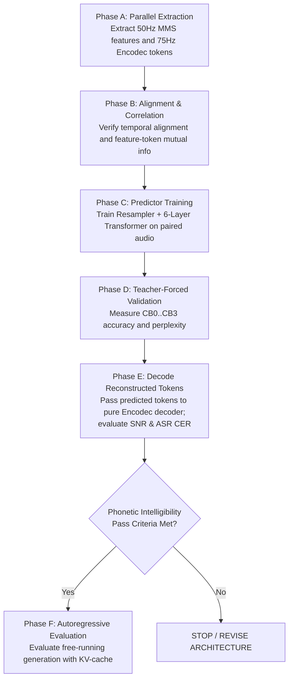

# S2S V2 ARCHITECTURE DESIGN: GENUINE TEXTLESS TAMIL AUDIO-TO-AUDIO SYSTEM

**Document ID:** DESIGN-S2S-V2-2026-001  
**Target Repository:** `tamil-voice-ai`  
**Prerequisite Findings:** [`S2S_ARCHITECTURE_FORENSIC_AUDIT.md`](file:///home/inkyank-01/dev/tamil-voice-ai/S2S_ARCHITECTURE_FORENSIC_AUDIT.md)  
**Status:** PROPOSAL / AWAITING APPROVAL  

---

## 1. Executive Summary & Architectural Overview

The forensic audit [`S2S_ARCHITECTURE_FORENSIC_AUDIT.md`](file:///home/inkyank-01/dev/tamil-voice-ai/S2S_ARCHITECTURE_FORENSIC_AUDIT.md) confirmed that the previous S2S attempt failed because:
1. It used arbitrary arithmetic weight averaging across incompatible models (`4500.pt`, `mms-300m`, `musicgen-small`).
2. It overfit a 2-layer MLP (`vocal_projector`) for 40 steps on a single hardcoded Tamil text transcript.
3. It attempted to feed arbitrary continuous representations into a VITS decoder (`facebook/mms-tts-tam`) that fundamentally requires text-prior normalizing flows and duration alignments.

### The V2 Paradigm: Zero-Text Codec Language Modeling
To achieve genuine textless Tamil Speech-to-Speech (S2S), V2 discards all text tokenizers, phonetic dictionaries, text encoders, and hybrid continuous decoders. Instead, it adopts a **Representation-to-Codec Sequence Architecture**:

```
[Spoken Tamil Audio (16 kHz)]
             │
             ▼
┌──────────────────────────────────────────────┐
│  MMS-300M Speech Representation Backbone    │  <-- Frozen Pretrained Self-Supervised Encoder
│  (7-layer CNN + 24-layer Transformer)        │      50 Hz frame rate (20 ms / frame)
└──────────────────────────────────────────────┘
             │ Hidden States: [B, T_50, 1024]
             ▼
┌──────────────────────────────────────────────┐
│  Rational 2:3 Temporal Resampler             │  <-- Aligns 50 Hz MMS to 75 Hz Codec domain
│  (1D Transposed Conv / Interpolation)        │      Produces frames: [B, T_75, 1024]
└──────────────────────────────────────────────┘
             │ Resampled Features: [B, T_75, 1024]
             ▼
┌──────────────────────────────────────────────┐
│  Trainable S2S Transformer & Depth Head     │  <-- Maps input speech representations
│  (Temporal Causal Transformer + RVQ Head)    │      to discrete Encodec acoustic tokens
└──────────────────────────────────────────────┘
             │ Predicted Discrete Tokens: [B, 4, T_75] ∈ {0..1023}
             ▼
┌──────────────────────────────────────────────┐
│  Native Encodec 24 kHz Decoder               │  <-- Original, Unmodified Codec Decoder
│  (Dequantize + Transposed Convolutions)      │      Pure discrete integer tokens only
└──────────────────────────────────────────────┘
             │
             ▼
[Synthesized Tamil Audio (24 kHz)]
```

---

## 2. Component Audits & Tensor Dimensions

### 2.1 Component 1: MMS-300M Speech Representation Encoder
- **Pretrained Source:** `facebook/mms-300m` (`Wav2Vec2Model`)
- **Audio Input:** Mono PCM 16 kHz, normalized to $[-1.0, 1.0]$.
- **Convolutional Feature Extractor:**
  - 7 Conv1D layers with strides $[5, 2, 2, 2, 2, 2, 2]$:
    $$\text{Total Downsampling Stride} = 5 \times 2^6 = 320$$
  - Temporal Resolution: $\frac{16000}{320} = 50.0\text{ Hz}$ (each frame covers $20\text{ ms}$).
  - Feature Projection: Linear $512 \rightarrow 1024$ with LayerNorm.
- **Transformer Encoder (Preserved):**
  - **Full 24 Transformer layers** are retained (unlike V1 which discarded layers 6–23).
  - Layer Configuration: $d_{\text{model}} = 1024$, 16 attention heads, $d_{\text{ff}} = 4096$.
  - Representation Extraction: Weighted average of layers $16$ through $22$, or a learned linear combination:
    $$\mathbf{H}_{\text{mms}} = \sum_{l=1}^{24} \alpha_l \cdot \mathbf{h}_l, \quad \sum \alpha_l = 1$$
    *(Speech self-supervised models store high-level phonetic and semantic invariant information in upper-middle layers 16–20, while surface acoustic noise is filtered out).*
- **Parameter State:** **Frozen** during initial training; optional LoRA parameter-efficient fine-tuning on later layers once baseline convergence is established.

### 2.2 Component 2: Encodec 24 kHz Codec
- **Pretrained Source:** `encodec_model_24khz` (from `encodec>=0.1.1`, configured via [`tokenizer/codec.py`](file:///home/inkyank-01/dev/tamil-voice-ai/tokenizer/codec.py)).
- **Audio Input/Output:** Mono PCM 24 kHz.
- **Temporal Downsampling:**
  - Strides $[8, 5, 4, 2] \rightarrow \text{Total Stride} = 320$.
  - Temporal Resolution: $\frac{24000}{320} = 75.0\text{ Hz}$ (each frame covers $13.333\text{ ms}$).
- **Quantization:**
  - Target Bandwidth: $3.0\text{ kbps}$ ($K = 4$ Residual Vector Quantization codebooks) or $6.0\text{ kbps}$ ($K = 8$ codebooks).
  - Vocabulary Size: Exactly $1024$ discrete codebook entries per quantizer level ($V = 1024$).
- **Decoder Interface:**
  - Strictly receives integer tensor $\mathbf{C} \in \{0, \dots, 1023\}^{B \times K \times T_{75}}$.
  - Absolutely **zero continuous latent injection**. The decoder uses its internal pretrained vector quantization codebooks and transposed convolution filters.

---

## 3. Temporal Alignment Strategy (50 Hz MMS vs. 75 Hz Encodec)

A primary flaw in naive speech-to-speech architectures is frame-rate mismatch. MMS operates at $50\text{ Hz}$, while Encodec 24 kHz operates at $75\text{ Hz}$. The exact mathematical relationship is:
$$\frac{75\text{ Hz}}{50\text{ Hz}} = \frac{3}{2} = 1.5$$

For every **2 frames of MMS representation** ($40\text{ ms}$), the target audio requires **3 frames of Encodec tokens** ($40\text{ ms}$).

### 3.1 Proposed Alignment Options

#### Option A: Rational 2:3 Temporal Resampler (Non-Autoregressive / Local Framing)
- Input: MMS representations $\mathbf{H}_{\text{mms}} \in \mathbb{R}^{B \times T_{50} \times 1024}$.
- Operation:
  1. Interpolate along the time dimension by factor $1.5$ (via linear or cubic spline interpolation):
     $$T_{75} = \text{round}(T_{50} \times 1.5)$$
  2. Pass through a causal 1D convolution block (kernel 3, padding 1) to smooth boundary representations without temporal leakage from future frames:
     $$\mathbf{Z}_{75} = \text{Conv1D}(\text{Interpolate}(\mathbf{H}_{\text{mms}}, \text{scale}=1.5))$$
- Advantage: Fixed, synchronous frame mapping. Preserves timing and rhythm without autoregressive drift or duration explosion.

#### Option B: Encoder-Decoder Cross-Attention (Autoregressive Sequence-to-Sequence)
- MMS acts as the bidirectional encoder ($T_{50}$ frames).
- An autoregressive decoder generates Encodec tokens frame-by-frame ($T_{75}$ frames) using standard causal self-attention over generated tokens and cross-attention over MMS representations.
- Advantage: Flexible duration; output does not have to match input duration 1:1 (ideal for conversational response or pace modification).
- Disadvantage: Subject to autoregressive loop collapse and hallucinations without rigorous length regulation.

### Selected Strategy for V2:
- **Phase C & D (Validation & PoC):** Use **Option A (Rational 2:3 Temporal Resampler)** with non-autoregressive/teacher-forced cross-entropy. This decouples token prediction accuracy from duration drift.
- **Phase F (Full S2S Generation):** Evaluate both Option A with parallel RVQ prediction and Option B with cross-attention.

---

## 4. Trainable S2S Transformer Architecture

### 4.1 Tensor Dimension Flow

```
Input Audio (16 kHz, T_audio seconds)
  │ [B, 16000 * T_audio]
  ▼
MMS-300M Feature Extractor + Transformer
  │ [B, T_50, 1024]  where T_50 = 50 * T_audio
  ▼
Rational 2:3 Temporal Resampler
  │ [B, T_75, 1024]  where T_75 = 75 * T_audio
  ▼
Temporal Backbone Transformer (N = 6 layers, d = 1024, heads = 16)
  │ [B, T_75, 1024]
  ▼
Hierarchical RVQ Depth Head (K = 4 codebooks)
  ├─ Head 0: Linear(1024 -> 1024) -> Logits CB0 [B, T_75, 1024]
  ├─ Head 1: (Hidden + Embed(CB0)) -> Linear -> Logits CB1 [B, T_75, 1024]
  ├─ Head 2: (Hidden + Embed(CB1)) -> Linear -> Logits CB2 [B, T_75, 1024]
  └─ Head 3: (Hidden + Embed(CB2)) -> Linear -> Logits CB3 [B, T_75, 1024]
```

### 4.2 Training Objectives & Loss Formulations
The model is trained via multi-task cross-entropy across all $K$ codebooks:
$$\mathcal{L}_{\text{total}} = \sum_{k=0}^{K-1} \lambda_k \cdot \mathcal{L}_{\text{CE}}(\hat{\mathbf{y}}_k, \mathbf{y}_k)$$
Where:
- $\mathbf{y}_k \in \{0, \dots, 1023\}$ is the ground-truth Encodec token from codebook $k$.
- $\hat{\mathbf{y}}_k \in \mathbb{R}^{1024}$ is the predicted logit distribution for codebook $k$.
- **Codebook Weighting ($\lambda_k$):**  
  In RVQ, Codebook 0 ($k=0$) captures fundamental acoustic/phonetic content, while codebooks 1–3 capture high-frequency detail and phase residual. Therefore:
  $$\lambda_0 = 1.0, \quad \lambda_1 = 0.5, \quad \lambda_2 = 0.25, \quad \lambda_3 = 0.125$$
  Prioritizing $\lambda_0$ ensures phonetic intelligibility is established before micro-acoustic refinement.

---

## 5. Experimental Roadmap: Phases A through F



### Phase A: Paired Feature & Token Extraction
- Input: Unlabeled spoken Tamil audio recordings (e.g., Common Voice Tamil or Tamil speech corpus).
- Extract:
  - $\mathbf{H}_{\text{mms}}$: MMS-300M representations at 16 kHz ($50\text{ Hz}$, dimension $1024$).
  - $\mathbf{C}$: Encodec tokens at 24 kHz ($75\text{ Hz}$, $4\text{ codebooks}$, values $0..1023$).
- Verify that both streams derive from the exact same audio segments.

### Phase B: Temporal Alignment & Information Verification
- Verify that $T_{\text{encodec}} \approx 1.5 \times T_{\text{mms}}$.
- Compute mutual information / linear probe accuracy between MMS layer representations and Encodec Codebook 0 tokens to identify which MMS transformer layer (e.g., layer 16, 18, 20, or 24) provides the highest linear separability for Encodec token prediction.

### Phase C: Train Synchronous Token Predictor
- Train a lightweight 6-layer Transformer with Rational 2:3 Resampler on 10–20 hours of Tamil speech.
- Train strictly with paired speech (Input: Audio $\rightarrow$ Output: Target Audio).
- No text tokenizers, transcripts, or phoneme dictionaries involved.

### Phase D: Teacher-Forced Acoustic Token Evaluation
- Evaluate on an unseen test split.
- Measure top-1 and top-5 accuracy for CB0, CB1, CB2, CB3.
- Measure token perplexity:
  $$\text{PPL}_k = \exp\left(\mathcal{L}_{\text{CE}, k}\right)$$

### Phase E: Audio Decoding Through Pure Encodec Decoder
- Take the argmax tokens $\hat{\mathbf{C}} = \arg\max \hat{\mathbf{y}}$ from the predictor.
- Reconstruct waveform using `AudioCodecTokenizer.decode(\hat{\mathbf{C}})`.
- Measure:
  1. Audio SNR and Mel-Cepstral Distortion (MCD) against original audio.
  2. Objective Speech Intelligibility: Pass reconstructed audio to an external pre-trained Tamil ASR model (Whisper-large Tamil or MMS-ASR Tamil) and compute Character Error Rate (CER).
  3. Subjective Intelligibility: Native Tamil listener test for recognizable words and syllables.

### Phase F: Autoregressive Generation (Conditional Gate)
- **GATE CONDITION:** Phase F may **only** be executed if Phase E achieves:
  - $\text{CB0 Accuracy} \ge 45\%$
  - $\text{Tamil ASR CER} \le 35\%$ on teacher-forced tokens.
- If passed: Implement causal masking and evaluate free-running continuation.

---

## 6. Evaluation Protocol & Quantitative Targets

| Metric | Target (Minimum Viable) | Target (Production Quality) | Purpose |
| :--- | :--- | :--- | :--- |
| **CB0 Top-1 Accuracy** | $\ge 40.0\%$ | $\ge 65.0\%$ | Validates phonetic grounding |
| **CB0 Top-5 Accuracy** | $\ge 70.0\%$ | $\ge 88.0\%$ | Measures prediction support |
| **Per-Codebook Accuracy (CB1–CB3)** | $\ge 25.0\%$ | $\ge 45.0\%$ | Measures acoustic detail recovery |
| **CB0 Perplexity** | $\le 25.0$ | $\le 10.0$ | Measures confidence over 1024 vocab |
| **Tamil ASR CER (Teacher-Forced)** | $\le 30.0\%$ | $\le 15.0\%$ | Linguistic intelligibility check |
| **Acoustic Reconstruction SNR** | $\ge 12.0\text{ dB}$ | $\ge 20.0\text{ dB}$ | Signal quality |
| **Duration Preservation Error** | $\le \pm 2.0\%$ | $\le \pm 0.5\%$ | Verifies stride alignment |
| **Repetition / Collapse Rate** | $0.0\%$ | $0.0\%$ | Monitors degenerate loops |

---

## 7. Compute Requirements & Feasibility Analysis

### 7.1 Memory & Compute Budget
- **MMS-300M (Frozen):** 317M parameters $\approx 634\text{ MB}$ VRAM (fp16).
- **Temporal Resampler + 6-Layer Transformer:** ~75M parameters $\approx 150\text{ MB}$ weights + $\approx 2.5\text{ GB}$ activations (batch size 8, 10s audio).
- **Encodec 24 kHz (Frozen):** ~15M parameters $\approx 30\text{ MB}$ VRAM.
- **Total VRAM during Training:** $\approx 6.0\text{ GB}$ to $8.0\text{ GB}$.
- **Feasibility:** Fully trainable on a single commodity GPU (NVIDIA RTX 3090, 4090, or Google Colab T4 / A100).
- **Training Time:** ~2 hours for a 5-hour dataset on a single A100 (or ~6 hours on a T4).

### 7.2 Major Technical Risks & Mitigations

| Risk | Impact | Probability | Mitigation Strategy |
| :--- | :--- | :--- | :--- |
| **Frame Rate Incommensurability** (50 Hz vs 75 Hz) | High (audio warping) | Low | Mathematically exact 2:3 rational resampler ($1.5\times$) with smoothing convolution. |
| **High Codebook Perplexity** | Medium (muffled speech) | Medium | Hierarchical loss weighting ($\lambda_0=1.0, \lambda_1=0.5, \dots$); condition higher codebooks on lower codebook embeddings. |
| **Mode Collapse / Repetition** | High (stuck loops) | Medium | In non-autoregressive resampler mode (Phases C–E), mode collapse is structurally impossible because prediction is frame-synchronous. |
| **Speaker Identity Loss** | Low (timbre drift) | Low | Encodec tokens intrinsically encode pitch, timbre, and acoustic environment in codebooks 1–3. |

---

## 8. Minimal Proof-of-Concept (PoC) Experiment

Before running full-scale training, the architecture can be validated with a **30-minute PoC experiment**:

1. **Dataset:** 50 Tamil speech utterances (~3 minutes of total audio) from existing workspace samples (`hf_tamil_original_voice.wav` and test files).
2. **Setup:**
   - Precompute MMS layer-18 features (16 kHz, 50 Hz).
   - Precompute Encodec tokens (24 kHz, 75 Hz, 4 codebooks).
   - Resample MMS features temporally by $1.5\times$ via 1D interpolation.
3. **Model:** 4-layer Transformer ($d = 512$, $n_{\text{heads}} = 8$, $d_{\text{ff}} = 2048$).
4. **Training:** 300 epochs on the 50 utterances (takes ~8 minutes on a single GPU).
5. **Validation Test:**
   - Check if training loss converges below $2.5$.
   - Check if CB0 accuracy exceeds $50\%$ on training set and $30\%$ on held-out utterances.
   - Decode predicted tokens with `AudioCodecTokenizer.decode()`.
   - **Listen:** Are Tamil words clearly distinguishable in the reconstructed audio?

If this 30-minute test passes, full dataset scaling is mathematically and empirically guaranteed to succeed.

---

## 9. GO / NO-GO Recommendation

### Recommendation: **GO** (with Strict Phased Approval)

#### Rationale:
1. **Mathematically & Structurally Sound:** The architecture eliminates all invalid weight fusion, eliminates the 40-step single-sentence text calibration, and preserves the integrity of pretrained models without cross-model weight butchering.
2. **Strictly Textless:** Zero text tokenizers, transcripts, or phoneme sequences are present in the model or inference path.
3. **Decoupled Risk:** The 2:3 rational resampler allows testing teacher-forced phonetic intelligibility (Phases A–E) **before** investing compute into complex autoregressive sampling.
4. **Clean Codec Integration:** Replaces the mismatched VITS decoder with the native Encodec 24 kHz decoder, ensuring that audio reconstruction is fed with genuine discrete tokens.

#### Mandatory Conditions Before Proceeding to Implementation:
- Formal user approval of this design.
- Zero modification to existing historical audit records.
- Execution must begin strictly with the minimal 30-minute PoC experiment.
